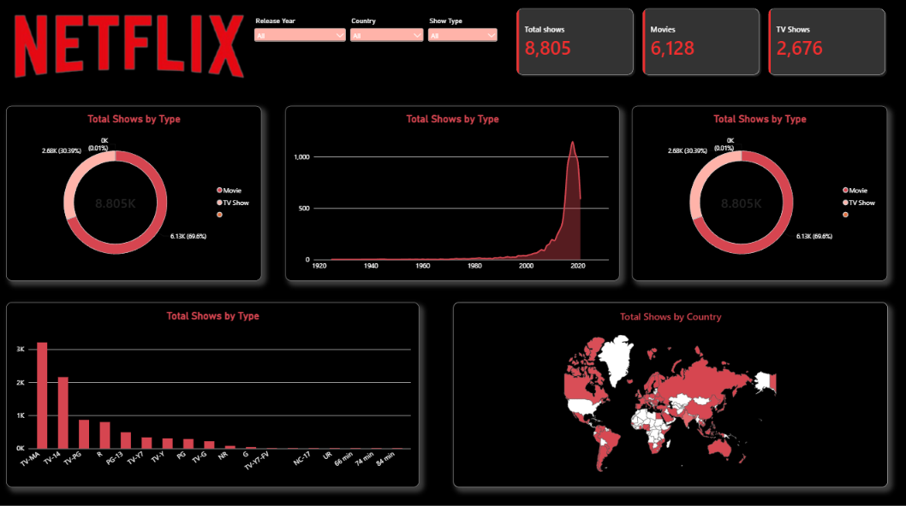

# Netflix Data Analysis Dashboard

## Project Overview
This project presents an interactive Netflix Data Analysis Dashboard built using Microsoft Power BI. It explores Netflix movies and TV shows based on release year, country, content type, and ratings.

## Tools Used
- Microsoft Power BI
- Power Query
- Data Visualization
- Data Cleaning

## Dashboard Features
- Total Shows KPI
- Movies and TV Shows analysis
- Release Year filter
- Country filter
- Show Type filter
- Content distribution by type
- Year-wise content trends
- Rating-wise content analysis
- Country-wise Netflix content visualization

## Key Insights
- Total Shows: 8,805
- Total Movies: 6,128
- Total TV Shows: 2,676
- Movies represent the largest content category.

## Dashboard Preview

## Project File
Netflix_Dashboard.pbix

## Author
Derangula Kavya
